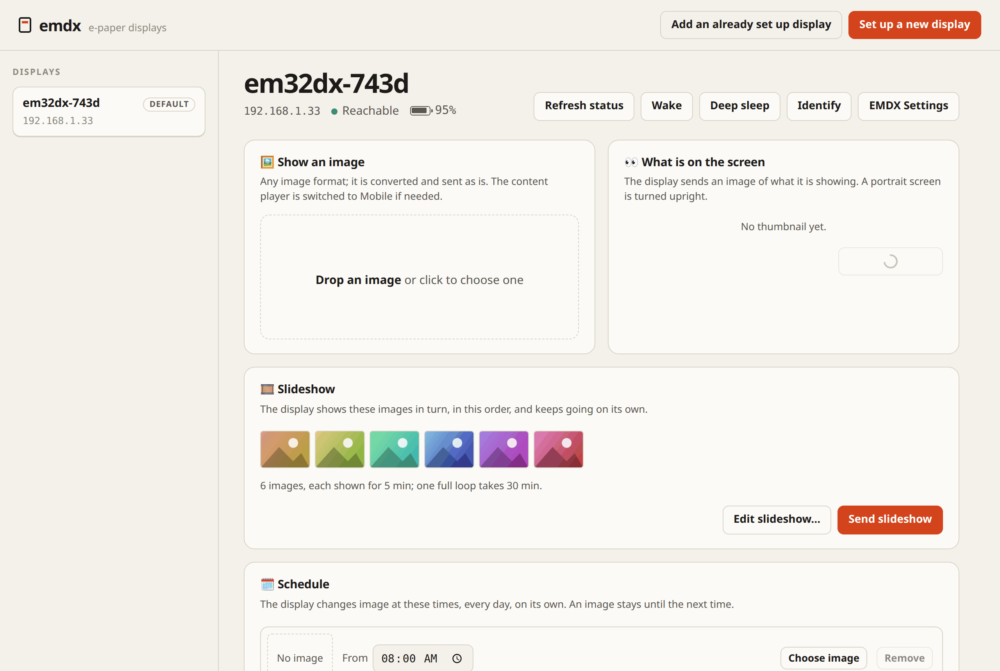

# emdx-controller

An unofficial, independent tool to control EMDX e-paper displays from a computer.

## 1. Introduction

I wanted to control my 32" e-paper display (EM32DX) from my own computer and my own
network, without the clunky phone app. This project does what the app does, and a bit
more:

- set up a new (or factory-reset) display over Bluetooth and put it on your network;
- show images on it, and an identification card to tell displays apart;
- ask the display what it is showing: it uploads a thumbnail of its own screen, which `emdx`
  saves and shows (in the web interface too);
- read its status (battery, network, identity) and change its settings (content player,
  orientation, background colour, sleep time, screen protection time, network standby);
- forget it: put it back in pairing mode, or erase its content.

Everything is in one small binary, `emdx`, with two ways to use it:

- a **command line** (`emdx --help`);
- a **web interface** with the same features (`emdx serve`).

Both share the same list of saved displays, so a display added in one shows up in the
other. Tested with an EM32DX on Linux.

## 2. Quick start

```bash
cargo build --release
./target/release/emdx setup lobby                    # set up a new display over Bluetooth
./target/release/emdx show-image --image photo.jpg   # show an image on it
./target/release/emdx serve                          # or use the web interface: http://localhost:3001
```

Bluetooth setup needs BlueZ's experimental API turned on: see
[How to compile](docs/build.md#requirements).



## 3. Documentation

- [How to compile](docs/build.md): requirements (Bluetooth / BlueZ), building, running the tests.
- [Command line](docs/cli.md): setting up and adding displays, showing images, thumbnails,
  status, settings, managing and forgetting displays, logs.
- [Web interface](docs/web.md): the same features from `emdx serve`, with screenshots.
- [Development](docs/development.md): how it works (MDC, content, thumbnails, Bluetooth
  setup), code map, adding a display command, tests.

## 4. Disclaimer

This is an independent, personal project. It is **not affiliated with, endorsed,
sponsored or supported by Samsung Electronics Co., Ltd.** or any of its subsidiaries.

- Samsung, EMDX, ePaper and all related names, logos, product names and trademarks are
  the property of Samsung Electronics Co., Ltd. They are used here only to identify the
  hardware this tool works with. All rights to Samsung's products, software, firmware,
  documentation and trademarks remain with Samsung; I don't own or claim any of them.
- This repository contains no Samsung software, firmware, source code or other assets.
  The only images of Samsung's interface are photos of my own display, taken to show how
  to use this tool. It talks to the display the way it was observed to communicate, for
  interoperability with hardware I own.
- The software is provided "as is", without warranty of any kind. Using it may affect your
  display, its warranty or your support options; you use it at your own risk. The author is
  not liable for any damage or loss resulting from its use.
