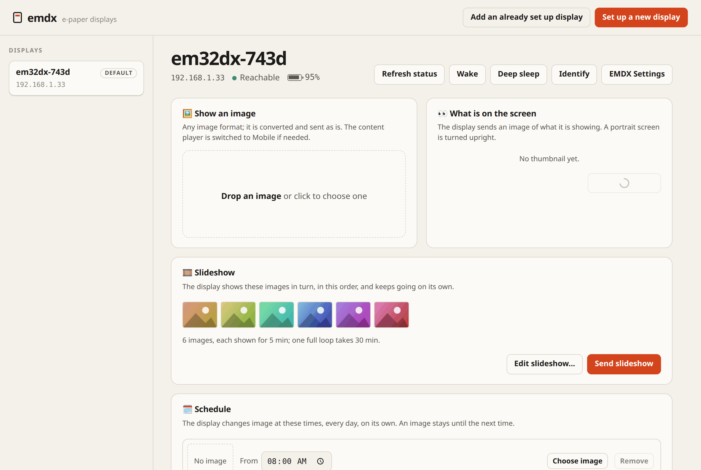
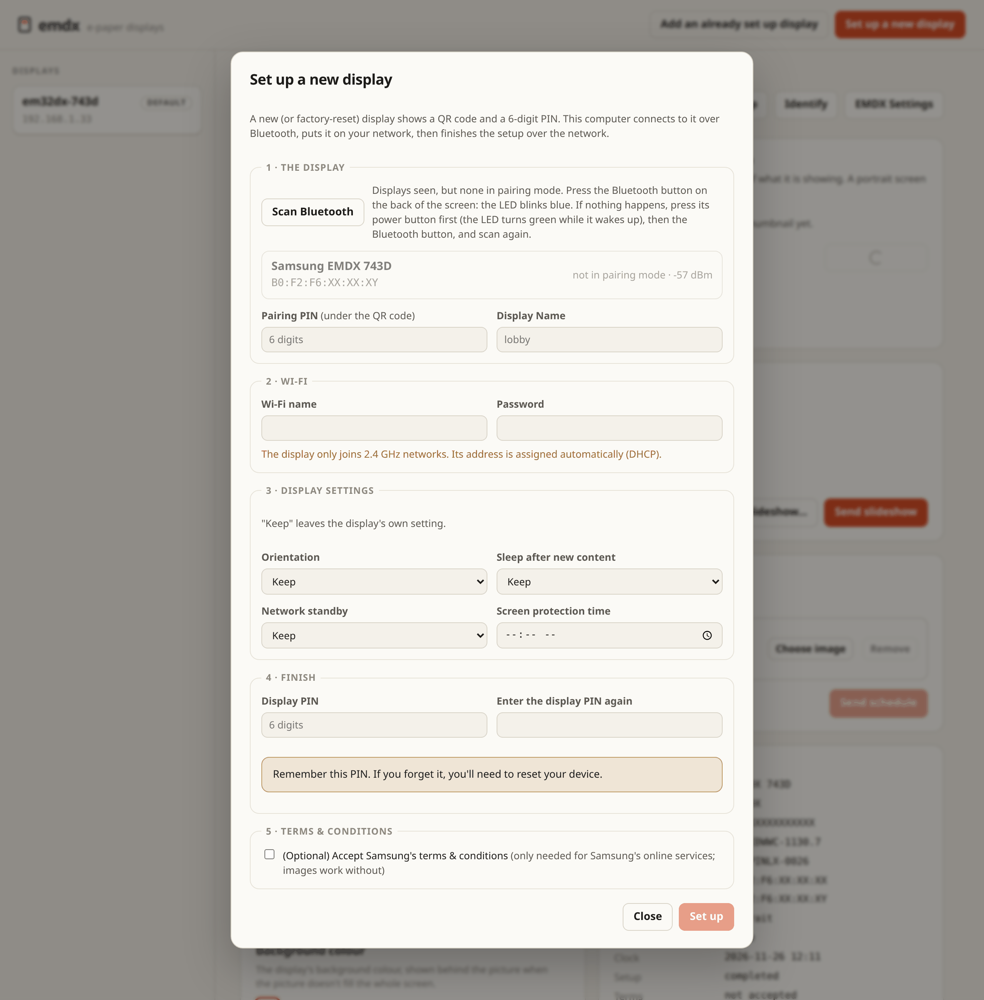
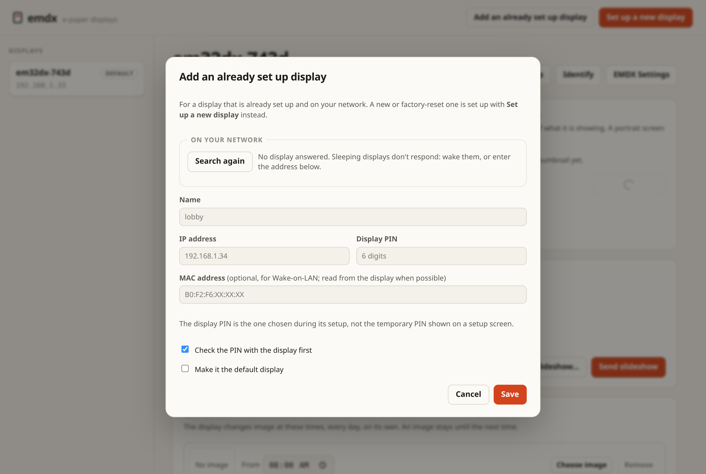
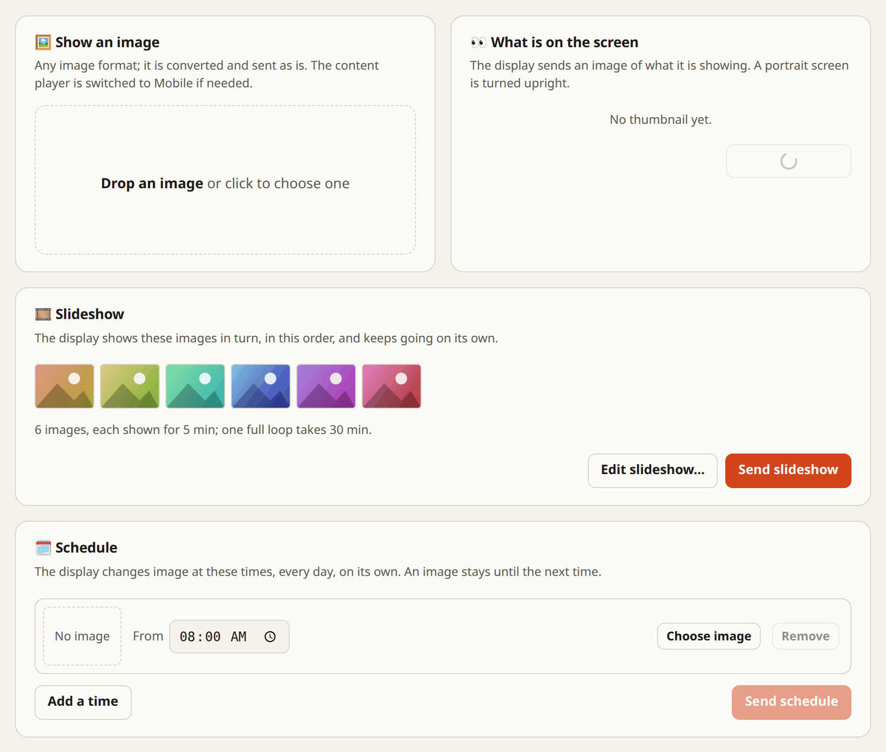
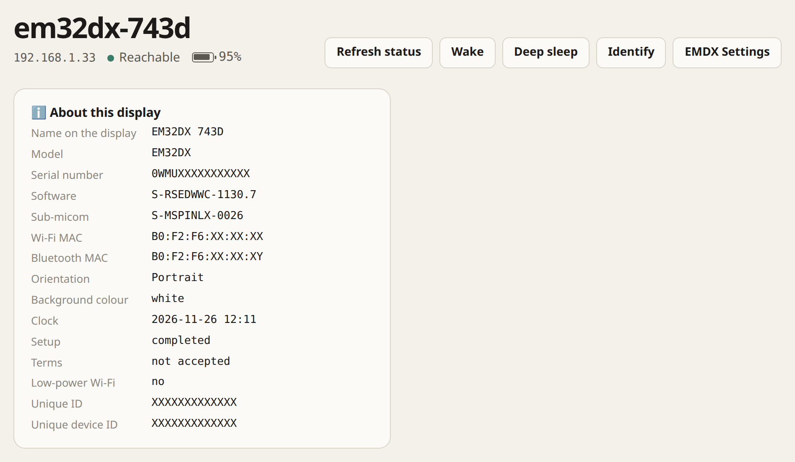
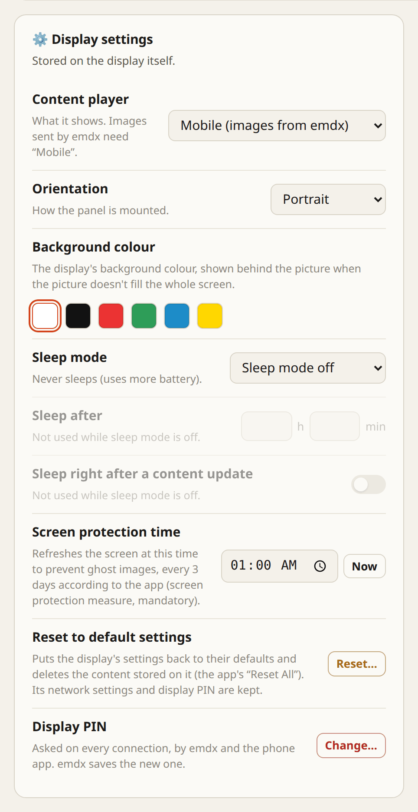
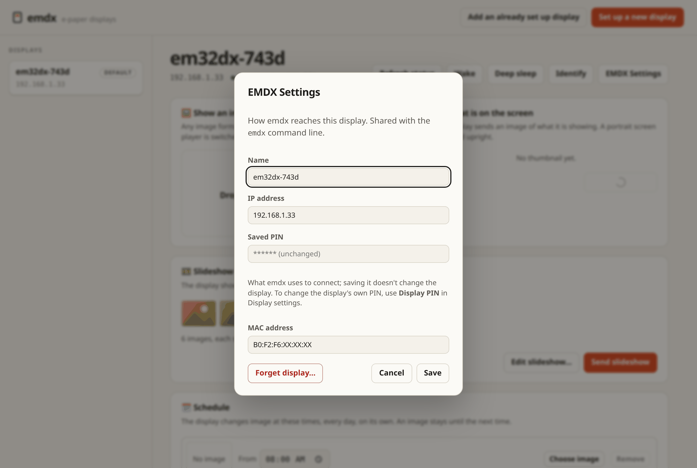
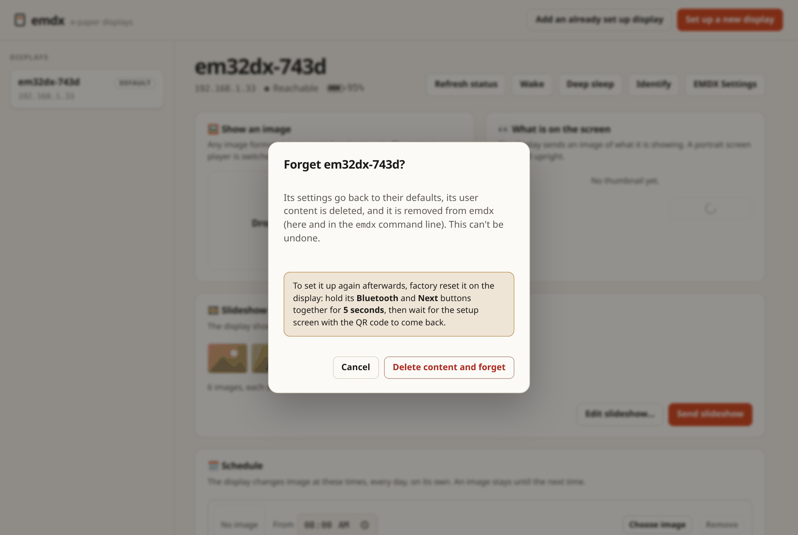

# Web interface

[← Back to the README](../README.md)

```bash
emdx serve                       # http://localhost:3001 (scans Wi-Fi every 2 min: --wifi-scan-every)
emdx serve --port 8080 --bind 127.0.0.1    # or EMDX_PORT / EMDX_BIND
```

The web interface has **no login**: anyone who can reach the port can control your
displays. On a shared network, use `--bind 127.0.0.1` or a firewall.



## Set up a fresh display (new, or factory reset)

**Set up a new display** (top right) opens the setup in five steps:
1. **The display:** scan Bluetooth and pick it (it must show its setup screen), enter the
   pairing PIN (under the QR code), and a display name, used both in emdx and on the display.
2. **Wi-Fi:** the network name and password (2.4 GHz only); the address is assigned
   automatically (DHCP).
3. **Display settings:** orientation (landscape or portrait), sleep time, network standby
   and screen protection time; "Keep" leaves the display's own setting.
4. **Finish:** the display PIN to use from now on (required, entered twice).
5. **Terms & conditions:** whether to accept Samsung's terms (optional; left unticked, they
   are declined).

**Set up** looks disabled until everything required is filled in; clicking it before then
says what is still missing.

The progress of the whole setup is shown live; at the end, the display appears in the
list and shows its identification image. The button only appears when `emdx` is built
with Bluetooth.

> [!NOTE]
> The pairing PIN only serves for this setup. Afterwards, the display uses the display PIN
> chosen in step 4, or the pairing PIN if you left it empty. A display that was set up
> before shows no PIN (the scan list says so): its pairing PIN is its display PIN.



## Add a display that is already set up (needs its display PIN)

**Add an already set up display** (top right) searches your network as it opens and lists the displays
that answer (marking ones already saved). Pick one to fill in its address and MAC, or type
the IP address yourself, then give it a name and its display PIN. The PIN is checked
before saving, and the MAC is read from the display when possible.

> [!NOTE]
> This needs the **display PIN**, the one chosen during the display's setup, not the
> temporary pairing PIN shown on a setup screen.



## Show an image

Drop an image on **Show an image**, or click it to choose one. Any image format works; it
is converted to JPEG before being sent, and the content player is switched to *Mobile* if
needed. **Identify** (top of the page) shows the display's name and details on it.

**Slideshow** (below) opens an editor: add images, drag them into order, set the time
between images (5 min to 24 h), then **Send to display**. The display keeps showing them in
turn by itself. Each display's slideshow is saved as you edit it, in
`~/.config/emdx/slideshows/<display>/` (`slideshow.json` and the images as JPEG), so it can
be changed and sent again later; it follows a renamed display and goes away with a removed one.

**Schedule** changes the image at set times of day, every day: **Add a time**, set when it
starts, choose its image, then **Send schedule**. An image stays until the next time.



## See what is on the screen

Every display card has a **"What is on the screen"** card: the last thumbnail the display sent,
with its title, content name and timestamp, plus an **Ask the display** button.

`emdx serve` starts the thumbnail receiver (HTTPS on port 6869, like the ePaper app) when it
boots, so a display also posts a new thumbnail by itself whenever what it shows changes; the
newest one per serial is kept. Every thumbnail is turned upright from the display's orientation
(a portrait screen arrives sideways), read from the display when it uploads:

```bash
curl localhost:3001/api/displays/lobby/thumbnail      # newest one, or 404
curl -X POST localhost:3001/api/displays/lobby/thumbnail   # ask, and wait up to 45 s
curl "localhost:3001/api/displays/lobby/thumbnail/image?file=SN123/thumbnail_x.jpg"
```

The image route only serves files `emdx` itself saved under its thumbnail directory.

## Check the status, wake it up or put it to sleep

The page reads the display when you select it: reachable or not, battery, and **About
this display** (model, serial, software, MACs, orientation, background colour, clock, setup state, unique
IDs). **Refresh status**, **Wake** and **Deep sleep** are at the top. Deep sleep warns first: only the
display's power button wakes it again, not the network (the warning can be turned off).



## Change the display settings

**Display settings** has the content player, orientation (landscape or portrait), background
colour (pick from the six the app offers — white, black, red, green, blue, yellow — shown as
colour swatches with the current one highlighted; the display has no other colour, so a custom
one has to be part of the image), sleep mode
(sleep, deep sleep or off, as in the app; it sets network standby), sleep after (5 min to
23 h 59 min; above 20 min it warns about power use), sleep right after a content update,
and the screen protection time (when the screen is refreshed to prevent ghost images, every 3 days
according to the app; **Now** refreshes at once). Changes apply as soon
as you pick a value.



## Manage the saved displays

The list on the left shows the saved displays (the same as `emdx displays`).
**EMDX Settings** (button at the top) changes a display's name, IP address, saved PIN or MAC address, or makes it the
default; the saved PIN there only changes what emdx uses. **Display PIN → Change…** in Display
settings sets a new PIN on the display itself (like the app's "Change PIN"); emdx checks that the
display accepts it, then saves it.



## Forget a display

**Forget display…** (in **EMDX Settings**) asks for confirmation, then puts the display's
settings back to their defaults, deletes its user content (the app's "Reset All", see
[Forget, re-pair or reset a display](cli.md#forget-re-pair-or-reset-a-display)) and removes it from the list. If it can't
be reached, nothing is removed unless you choose **Remove from emdx anyway**.

To set it up again, factory reset it on the display: hold its **Bluetooth** and **Next**
buttons together for 5 seconds, then wait for the setup screen with the QR code. It shows a
new pairing PIN, for **Set up a new display** (or `emdx setup`).



Resetting only the settings and erasing only the stored images are in the command line
(`emdx reset settings`, `emdx empty-storage`).
